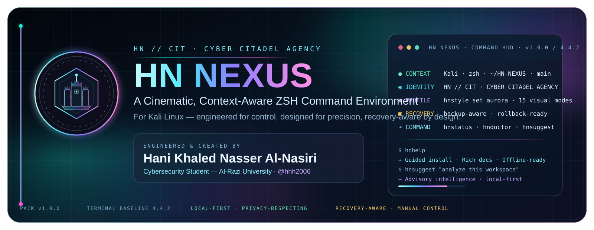
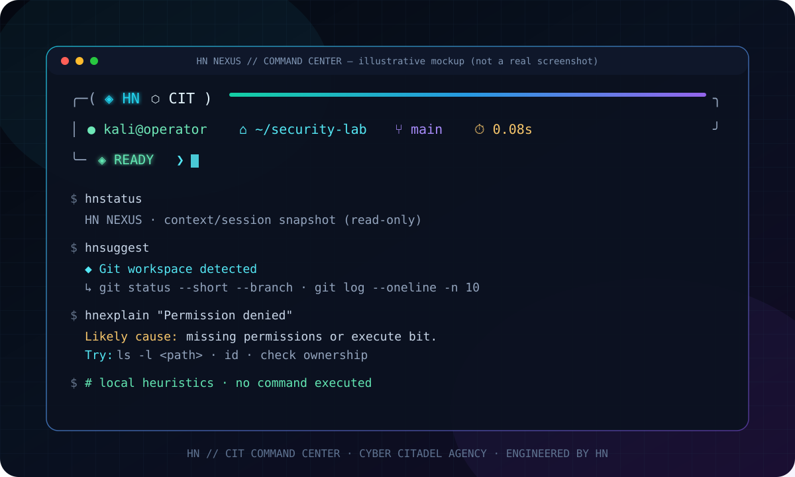

<div align="center">
  

  <p>
    
  </p>

  <p><strong>HN // CIT</strong> · <strong>CYBER CITADEL AGENCY</strong> · <strong>ENGINEERED BY HN</strong></p>

  <p>
    <a href="https://github.com/hhh2006/HN-NEXUS/actions/workflows/ci.yml"></a>
    <a href="https://github.com/hhh2006/HN-NEXUS/actions/workflows/pages.yml"></a>
    <a href="https://hhh2006.github.io/HN-NEXUS/"></a>
    <a href="https://github.com/hhh2006/HN-NEXUS/releases/tag/v1.0.0"></a>
    
    
    
    
    <a href="LICENSE"></a>
  </p>

  <p>
    <a href="https://hhh2006.github.io/HN-NEXUS/"><strong>🌐 Website</strong></a> ·
    <a href="docs/COMMAND-REFERENCE.md"><strong>⌘ Commands</strong></a> ·
    <a href="docs/TUTORIAL.md"><strong>📘 Tutorial</strong></a> ·
    <a href="docs/INSTALLATION-AND-RECOVERY.md"><strong>⛨ Install &amp; Recovery</strong></a> ·
    <a href="docs/ARCHITECTURE.md"><strong>▤ Architecture</strong></a> ·
    <a href="docs/FAQ.md"><strong>FAQ</strong></a> ·
    <a href="docs/TROUBLESHOOTING.md"><strong>Troubleshooting</strong></a>
  </p>

  <p>
    <sub>Created &amp; engineered by <strong><a href="https://github.com/hhh2006">Hani Khaled Nasser Al-Nasiri</a></strong> — Cybersecurity Student, Al-Razi University<br/>
    <em>Engineered for control. Designed for precision.</em></sub>
  </p>
</div>

<p align="center">
  
</p>

> **Illustrative preview:** the SVG mockups in this repository are high-quality design previews, **not fabricated real Kali/ZSH runtime screenshots**. Add genuine, privacy-scrubbed captures in `assets/screenshots/` (see `assets/screenshots/README.md`) before presenting them as real environment images.

---

## Overview

**HN NEXUS** is a cinematic, recovery-aware ZSH command environment for Kali Linux (and compatible Linux systems). It combines a **responsive three-row HUD**, **Prism visual profiles**, and a collection of **explicit, on-demand operator utilities** to make terminal work clearer, more contextual, and more deliberate — without taking control away from the user.

**Design principles:** local-first, user-controlled, native-first compatibility, transparent limitations, and recovery-aware installation.

- **Publishing pack:** `v1.0.0`
- **Terminal source baseline:** `4.4.2` (`VERSION` remains `4.4.2` to preserve runtime baseline integrity)
- **Primary identity:** `HN // CIT` · **Secondary:** `CYBER CITADEL AGENCY`

## At a Glance

| ✦ | Area | What it provides | Notes |
|---|---|---|---|
| ⌘ | **Terminal HUD** | Responsive three-row prompt (identity, context/path/status, ready/input) | Event-driven ZSH hooks; width-aware layout |
| ◈ | **Visual system** | 15 visual profiles (`hnstyle`), gradient rails, glyphs with fallbacks | Nerd Font improves appearance; fallbacks supported |
| ⌕ | **Context & assistance** | `hnsuggest`, `hnhistory-search`, `hnexplain`, `hnwhy` | Local heuristics, advisory only, never auto-executed |
| ▤ | **Operator utilities** | File/log/data viewers, process/service/container/port views, reports | Explicitly invoked, read-only where stated |
| ≋ | **Output intelligence** | `hnoutput`, `hnnet`, `hnanalyze` for supplied text | Heuristic classification; no scanning/capture/execution |
| ⟲ | **Native presentation** | Interactive wrappers for familiar commands (e.g. `cat`, `ip a/route/neigh`, `ps/df/free/ss/du`, `ls/tree`) | Preserves native behavior for pipes/redirections/unsupported cases; bypass with `command <name>` |
| ⛨ | **Recovery** | Guided install, backups, rollback artifacts, diagnostics | Not a full system snapshot; keep independent backups |
| 🌐 | **Website & docs** | Cinematic GitHub Pages site, comprehensive docs, guides, reports | SVG mockups + real-capture guidance |

## Identity & Attribution

<p align="center">
  
</p>

- **Creator:** **Hani Khaled Nasser Al-Nasiri (HN)** — *ENGINEERED BY HN*
- **Academic profile:** Cybersecurity Student — **Al-Razi University**
- **GitHub:** [@hhh2006](https://github.com/hhh2006)
- **Project identity:** **HN // CIT** (primary) · **CYBER CITADEL AGENCY** (secondary)
- **Signature:** **ENGINEERED BY HN**
- **CIT seal:** included as an official identity mark for this project’s HN // CIT branding (`assets/branding/cit-seal-emblem.png`, `website/assets/cit-seal-emblem.png`).

See [assets/branding/IDENTITY.txt](assets/branding/IDENTITY.txt) for design philosophy and attribution notes.

## Architecture (at a glance)

<p align="center">
  
</p>

HN NEXUS is organized into layered components (interactive shell core, HUD/context engine, on-demand utilities, and recovery/verification), with optional XFCE/X11 desktop theming kept separate from the core terminal experience. Full details: [docs/ARCHITECTURE.md](docs/ARCHITECTURE.md).

## Requirements

- **OS:** Kali Linux (recommended) or a compatible Linux distribution
- **Required:** ZSH, Python 3, Bash (for setup/scripts)
- **Recommended:** truecolor-capable terminal and a Nerd Font for best visual fidelity (fallbacks supported)
- **Optional visual theme (XFCE/X11):** active XFCE on X11, `xfconf-query`, `xfce4-terminal`
- **Optional feature deps (used if installed):** `fzf`, `bat`/`batcat`, `jq`, `yq`, `rg`, `eza`, `tree`, `diff`/`colordiff`, `docker`/`podman`, `systemctl`, `ss`

## Quick start (step-by-step)

> Run as a **normal user**. **Do not** use `sudo` for project installers. Review scripts before execution and keep independent backups.

1. **Download and extract** the project (trusted source), then open a terminal in the extracted folder.
2. **Make scripts executable (if needed):**
   ```bash
   chmod +x setup.sh install.sh uninstall.sh
   ```
3. **Check prerequisites (no changes):**
   ```bash
   ./setup.sh --check
   ```
4. **Preview guided plan (no changes):**
   ```bash
   ./setup.sh --dry-run
   ```
5. **Run guided installation:**
   ```bash
   ./setup.sh
   ```
   - Installs core ZSH configuration with timestamped backups and recovery artifacts.
   - On supported **XFCE/X11** sessions, may prompt once to apply optional desktop styling. Otherwise, core installs and visual styling is safely skipped/reported.
6. **Open a new ZSH terminal and verify:**
   ```zsh
   hnhelp
   hnstatus
   hnvisual
   hndoctor
   ```

**Advanced modes:** `./setup.sh --core` (terminal only), `./setup.sh --visual` (XFCE/X11 visual layer), `./setup.sh --full` (guided full).  
**Recovery/uninstall:** `./uninstall.sh` (review prompts/output; recovery is not a full system snapshot).

Full operator guide: [docs/INSTALLATION-AND-RECOVERY.md](docs/INSTALLATION-AND-RECOVERY.md)

## Usage & command documentation

Start with `hnhelp` (quick reference) and `hnmenu` (interactive launcher). For complete, behavior-accurate documentation with examples, see **[docs/COMMAND-REFERENCE.md](docs/COMMAND-REFERENCE.md)**.

### Command categories (summary)

- **Help & discovery:** `hnhelp`, `hnmenu`, `hnsearch`, `hnstatus`, `hnprism`, `hnvisual`, `hndoctor`, `hncolors`, `hnicons`
- **Visual profile:** `hnstyle [auto|emerald|sapphire|amethyst|arctic|rose|turquoise|indigo|lilac|jade|polar|royal|matrix|blood|quantum|obsidian]`
- **Context & assistance (heuristic, advisory):** `hnsuggest`, `hnhistory-search`, `hnhistory`, `hnexplain`, `hnwhy`
- **Files, logs & viewing:** `hnfiles`, `hnicon`, `hncat`, `hnlog`, `hnjson` (jq), `hnyaml` (yq), `hnfind`, `hninspect`, `hndiff`, interactive `cat` presentation
- **System & operations (read-only views):** `hnops`, `hnports`, `hnproc`, `hnhealth`, `hnservices`, `hncontainers`, `hnreport`, interactive `ps`/`df`/`free`/`ss`/`du`
- **Network & output intelligence (supplied/local, read-only):** `hnipa`, supported `ip a|route|neigh` views, `hnnet`, `hnanalyze`, `hnoutput`
- **Helpers:** `mkcd`, `extract`, interactive `ls`/`tree`, optional `l/ll/la/lt` (eza)

### Example workflows

```zsh
# Discover and inspect
hnhelp
hnsearch "route"
hnstatus && hndoctor

# Context-aware suggestions (never executed)
hnsuggest

# Safe history recall (inserted for review, not executed)
hnhistory-search git

# Explain failures (heuristic)
false; hnwhy
some_command 2>&1 | hnexplain

# View and inspect
hnfiles
hncat README.md
hnlog /var/log/syslog
hninspect setup.sh

# Triage supplied output (no scanning/capture)
hnanalyze scan.txt
make 2>&1 | hnoutput -

# Visual profile
hnstyle royal
hnstyle auto
```

**Native behavior:** pipes/redirections and unsupported cases are designed to fall back to native commands for supported wrappers. Use `command <name> ...` to bypass presentation explicitly.

## Beginner + advanced learning

- **[Tutorial (Beginner → Advanced)](docs/TUTORIAL.md)** — guided installation, verification, daily workflows, customization, scripting awareness, and recovery mindset.
- **[Command Reference](docs/COMMAND-REFERENCE.md)** — complete usage and examples.
- **[Configuration](docs/CONFIGURATION.md)** — customization notes.
- **[Visual assets](docs/VISUAL-ASSETS.md)** — branding, mockups, and real-capture guidance.

## Documentation hub

- [Installation & Recovery](docs/INSTALLATION-AND-RECOVERY.md) · [Quick install](docs/INSTALLATION.md)
- [Command Reference](docs/COMMAND-REFERENCE.md) · [Tutorial](docs/TUTORIAL.md)
- [Architecture](docs/ARCHITECTURE.md) · [FAQ](docs/FAQ.md) · [Troubleshooting](docs/TROUBLESHOOTING.md)
- [Operator Utilities](docs/OPERATOR-UTILITIES.md) · [Output Intelligence](docs/OUTPUT-INTELLIGENCE.md) · [Network Intelligence](docs/NETWORK-INTELLIGENCE.md)
- [Configuration](docs/CONFIGURATION.md) · [Theme/Visual notes](docs/THEME-ARCHITECTURE.md) · [Visual assets](docs/VISUAL-ASSETS.md)
- [Changelog](docs/CHANGELOG.md) · [Publishing checklist](docs/PUBLISHING-CHECKLIST.md)
- [Test report v1.0.0](docs/TEST-REPORT-v1.0.0.md) (and historical reports in `docs/`)

## Website & project links

- **Live site (GitHub Pages):** https://hhh2006.github.io/HN-NEXUS/
- **Repository:** https://github.com/hhh2006/HN-NEXUS
- **Latest release (v1.0.0):** https://github.com/hhh2006/HN-NEXUS/releases/tag/v1.0.0
- **Deployments:** https://github.com/hhh2006/HN-NEXUS/deployments (`github-pages`)
- **Actions / CI:** https://github.com/hhh2006/HN-NEXUS/actions

The site is a cinematic, responsive experience built from `website/` and deployed via **GitHub Actions** (repository Pages source must be **GitHub Actions**). Current deployment status in GitHub shows Pages configured and a successful Pages deploy for the latest published commit.

**If the website does not open (including regional/network blocks):**
1. **Check deployment status:** [Pages workflow](https://github.com/hhh2006/HN-NEXUS/actions/workflows/pages.yml) and [Pages settings](https://github.com/hhh2006/HN-NEXUS/settings/pages). A successful Pages deployment means GitHub published the site.
2. **Use the exact URL:** `https://hhh2006.github.io/HN-NEXUS/` and wait a few minutes after a fresh deploy for DNS/edge propagation and caching.
3. **Refresh/cache:** hard-refresh (`Ctrl+F5`) or try an incognito/private window.
4. **Network/DNS/ISP/region:** some networks, ISPs, or countries may block or delay `github.io` (this can be outside the repository’s control). Try another browser, device, network, or DNS/VPN if available to you.
5. **Guaranteed fallback access:** browse the full documentation directly in this repository (`docs/`, `README.md`), download assets from the [v1.0.0 release](https://github.com/hhh2006/HN-NEXUS/releases/tag/v1.0.0), or clone/download the repo and open `website/index.html` locally for a static preview of the project page.

## Validation & quality notes

- Feasible checks in the packaging environment were run where possible (e.g. website link/asset validation). Full ZSH runtime, ShellCheck, installer/restore, XFCE visual, and GitHub CI/Pages validation depend on target environments.
- See **[docs/TEST-REPORT-v1.0.0.md](docs/TEST-REPORT-v1.0.0.md)** for executed checks, results, and documented limitations.
- A **skipped** test is not a pass.

## Safety, privacy, and limitations

- HN NEXUS does **not** perform network scanning, packet capture, or autonomous command execution. Text intelligence helpers analyze user-supplied/local text heuristically.
- Installer/recovery operations are **not** a full system snapshot. Keep independent backups.
- Reports, logs, history, and captures may contain sensitive information — **review and redact** before sharing.
- Review scripts before execution. See [SECURITY.md](SECURITY.md) and [SUPPORT.md](SUPPORT.md).

## Repository structure

```text
config/        ZSH runtime: prompt/HUD engine and tools/utilities
tests/         Static, geometry/theme, rollback, intelligence, and website checks
docs/          Documentation, guides, changelog, and test/release reports
website/       GitHub Pages site (cinematic UI, docs routes, assets)
assets/        Branding SVGs, mockups, and screenshot guidance/placeholders
theme/         Optional XFCE/X11 theme assets
recovery/      Verification and recovery helpers
.github/       CI and Pages workflows, templates
```

## Releases

- **Pack:** `v1.0.0` · **Terminal baseline:** `4.4.2`
- Release notes: [RELEASE-NOTES-v1.0.0.md](RELEASE-NOTES-v1.0.0.md)
- History: [docs/CHANGELOG.md](docs/CHANGELOG.md)

## Contributing

Contributions, bug reports, and documentation improvements are welcome. Please read [CONTRIBUTING.md](CONTRIBUTING.md) and follow project templates/policies.

## License & intellectual property

- **Code:** [MIT License](LICENSE) — Copyright (c) 2026 Hani Khaled Nasser Al-Nasiri (HN)
- **Identity/branding:** HN NEXUS, HN // CIT, and CYBER CITADEL AGENCY names/marks/visual identity are attributed to the author unless otherwise noted. See [assets/branding/IDENTITY.txt](assets/branding/IDENTITY.txt).

---
<div align="center">

**HN // CIT · CYBER CITADEL AGENCY · ENGINEERED BY HN**  
*Engineered for control. Designed for precision.*

</div>
