<div align="center">
  

  <br/>

  <p>
    <a href="https://github.com/hhh2006/HN-NEXUS/actions/workflows/ci.yml"></a>
    <a href="https://github.com/hhh2006/HN-NEXUS/actions/workflows/pages.yml"></a>
    <a href="https://hhh2006.github.io/HN-NEXUS/"></a>
    <a href="https://github.com/hhh2006/HN-NEXUS/releases/tag/v1.0.0"></a>
    
    
    
    
  </p>

  <h3>
    
    &nbsp; HN // CIT &nbsp;·&nbsp; CYBER CITADEL AGENCY &nbsp;·&nbsp; ENGINEERED BY HN &nbsp;
    
  </h3>

  <p><strong>Engineered for control. Designed for precision. Recovery-aware by design.</strong></p>

  <p>
    <a href="https://hhh2006.github.io/HN-NEXUS/"><b>🌐 Cinematic Website</b></a> ·
    <a href="https://github.com/hhh2006/HN-NEXUS/releases/tag/v1.0.0"><b>⬇️ Release v1.0.0</b></a> ·
    <a href="docs/COMMANDS.md"><b>⌨️ Commands</b></a> ·
    <a href="docs/TUTORIAL.md"><b>🎓 Tutorial</b></a> ·
    <a href="docs/INSTALLATION-AND-RECOVERY.md"><b>🛠️ Install & Recovery</b></a> ·
    <a href="docs/ARCHITECTURE.md"><b>🏗️ Architecture</b></a> ·
    <a href="docs/FAQ.md"><b>❓ FAQ</b></a>
  </p>
</div>

<p align="center"></p>

> [!IMPORTANT]
> **Publishing pack:** `v1.0.0` · **Terminal source baseline:** `4.4.2` (kept as runtime baseline metadata for accuracy).
> **If GitHub Pages does not open in your network/region (e.g. some ISPs block `github.io`):** browse this repository and docs directly, download [Release v1.0.0](https://github.com/hhh2006/HN-NEXUS/releases/tag/v1.0.0), or open [`website/index.html`](website/index.html) locally after cloning/downloading. A successful GitHub Pages deploy means the site is published, but external network access can still be blocked.

## ⚡ Cinematic Command Center for Kali Linux / ZSH

**HN NEXUS** is a context-aware, recovery-aware ZSH command environment by **Hani Khaled Nasser Al-Nasiri** (Cybersecurity Student — Al-Razi University, [`@hhh2006`](https://github.com/hhh2006)). It pairs a **high-fidelity 3-row HUD prompt**, **15 Prism visual profiles** (`hnstyle`), guided installation/rollback, advisory intelligence (`hnsuggest`), diagnostics, and rich documentation — with a **local-first, privacy-respecting, manual-control** philosophy.

<div align="center">
  
  <br/>
  <sub><i>Illustrative cinematic mockup (SVG) — not a fabricated real Kali/ZSH runtime screenshot. Real captures belong in <a href="assets/screenshots/">assets/screenshots/</a>.</i></sub>
</div>

<p align="center"></p>

## ✨ Why HN NEXUS

<table>
<tr>
<td width="50%" valign="top">

### 🎛️ Cinematic, Context-Aware HUD
A responsive **three-row** event-driven prompt that surfaces workspace, git, runtime/tool, status, and navigation context with width-aware rendering and safe fallbacks.

### 🎨 15 Prism Visual Profiles
Switch the entire command-center feel instantly with `hnstyle` (session-local): `aurora`, `citadel`, `matrix`, `tokyo`, `ember`, and more — precise, readable, and intentional.

### 🛡️ Recovery-Aware by Design
Timestamped backups, guided install/rollback paths, and explicit recovery documentation. Control stays in your hands.

</td>
<td width="50%" valign="top">

### 🧠 Advisory Intelligence
`hnsuggest` provides **local-first, optional** command guidance based on detected context — helpful without background daemons or hidden automation.

### 🔒 Local-first & Privacy-Respecting
No telemetry pipeline required for core operation, no automatic package installation, and no compositor dependency for core terminal behavior.

### 📚 Rich, Honest Documentation
Architecture, commands, tutorial, troubleshooting, FAQ, recovery, and visual-asset guidance — documented clearly with illustrative mockups labeled as such.

</td>
</tr>
</table>

<p align="center"></p>

## 🧭 At a Glance

| | |
|---|---|
| **Identity** | **HN // CIT** · **CYBER CITADEL AGENCY** · **ENGINEERED BY HN** |
| **Creator** | **Hani Khaled Nasser Al-Nasiri** — Cybersecurity Student, Al-Razi University · [`@hhh2006`](https://github.com/hhh2006) |
| **Runtime** | Kali Linux · ZSH · `~/.zshrc`-based loader · event-driven HUD hooks |
| **Experience** | 3-row adaptive HUD · 15 visual profiles (`hnstyle`) · guided help/menu/status/doctor flows |
| **Intelligence** | `hnsuggest` advisory command guidance (local-first, optional) |
| **Safety** | Backups, rollback/recovery paths, no destructive hidden automation, manual control |
| **Docs & Site** | [Website](https://hhh2006.github.io/HN-NEXUS/), [Docs hub](docs/README.md), [Release v1.0.0](https://github.com/hhh2006/HN-NEXUS/releases/tag/v1.0.0) |

## 🚀 Quick Start

```bash
git clone https://github.com/hhh2006/HN-NEXUS.git
cd HN-NEXUS
./setup.sh --check     # inspect environment/readiness
./setup.sh --dry-run   # preview actions
./setup.sh             # guided install / apply
```

After install (in ZSH): `hnhelp`, `hnmenu`, `hnstatus`, `hndoctor`, `hnstyle list`, `hnsuggest "what can I do here?"`

> Read [Installation & Recovery](docs/INSTALLATION-AND-RECOVERY.md) before applying system-level changes. Keep backups and review rollback options.

<details>
<summary><b>📖 More command highlights</b></summary>

- **Help & discovery:** `hnhelp`, `hnmenu`, `hncmds`
- **Diagnostics & status:** `hnstatus`, `hndoctor`, `hncheck`
- **Visual profiles:** `hnstyle list`, `hnstyle set <profile>` (session-local)
- **Advisory guidance:** `hnsuggest "<context or goal>"`
- **Reference:** full inventory in [docs/COMMANDS.md](docs/COMMANDS.md)

</details>

<p align="center"></p>

## 🏛️ Agency Identity & Creator

<div align="center">
  
</div>

<br/>

| | |
|---|---|
| **Seal / Identity** | **Designed Cyber Citadel Agency seal** (SVG) created for HN NEXUS to present the **HN // CIT** identity in a premium, harmonious form. The creator-provided CIT seal is preserved as source/identity material in [`assets/branding/cit-seal.png`](assets/branding/cit-seal.png) with processed presentation variants (`cit-seal-emblem.png/.webp`). |
| **Project** | **HN NEXUS** — cinematic, recovery-aware ZSH command environment |
| **Agency** | **HN // CIT · CYBER CITADEL AGENCY** |
| **Signature** | **ENGINEERED BY HN** |
| **Creator** | **Hani Khaled Nasser Al-Nasiri** |
| **Role** | Cybersecurity Student — **Al-Razi University** |
| **GitHub** | [`@hhh2006`](https://github.com/hhh2006) · [hhh2006/HN-NEXUS](https://github.com/hhh2006/HN-NEXUS) |

<p align="center"></p>

## 🗺️ Architecture & Design Philosophy

- **Event-driven HUD:** prompt/HUD updates on ZSH hooks — no always-on polling daemon for core display.
- **Modular config:** terminal behavior and tools/help surfaces organized for clarity and maintainability.
- **Safe fallbacks:** width-aware rendering, Nerd Font detection with readable fallbacks.
- **Manual, inspectable control:** guided setup, explicit status/doctor checks, and documented recovery.

See [docs/ARCHITECTURE.md](docs/ARCHITECTURE.md) and the illustrative [architecture mockup](assets/branding/architecture-mockup.svg).

## 📚 Documentation Hub

| Start here | Deep dive |
|---|---|
| [Docs index](docs/README.md) | [Architecture](docs/ARCHITECTURE.md) |
| [Installation & Recovery](docs/INSTALLATION-AND-RECOVERY.md) | [Configuration](docs/CONFIGURATION.md) |
| [Tutorial](docs/TUTORIAL.md) | [Troubleshooting](docs/TROUBLESHOOTING.md) |
| [Commands](docs/COMMANDS.md) | [FAQ](docs/FAQ.md) · [Roadmap](docs/ROADMAP.md) |
| [Visual Assets](docs/VISUAL-ASSETS.md) | [Test Report v1.0.0](docs/TEST-REPORT-v1.0.0.md) |

Website pages mirror core docs under [`website/docs/`](website/docs/) for published browsing.

## ✅ Validation & Quality

- **Feasible local checks:** `python tests/website-check.py` used to validate website links/assets/routes in this packaging environment.
- **CI/Pages:** GitHub Actions workflows build/check and deploy Pages (see badges and [Actions](https://github.com/hhh2006/HN-NEXUS/actions)).
- **User-reported:** the project owner reported full feature/test pass in their environment (recorded in [Test Report](docs/TEST-REPORT-v1.0.0.md)).
- **Environment-dependent:** full ZSH/runtime, ShellCheck parity, installer/rollback, XFCE, and live network reachability may require target/Kali or external verification.

See [docs/TEST-REPORT-v1.0.0.md](docs/TEST-REPORT-v1.0.0.md) for details and limitations.

## 🔒 Security, Privacy & Support

- [SECURITY.md](SECURITY.md) — reporting and security posture notes
- [SUPPORT.md](SUPPORT.md) — help and project support
- [CODE_OF_CONDUCT.md](CODE_OF_CONDUCT.md) · [CONTRIBUTING.md](CONTRIBUTING.md)

Core design: **local-first**, **privacy-respecting**, **no hidden telemetry for core operation**, and **user-controlled** changes.

## 📦 Release & Versioning

- **Pack release:** [`v1.0.0`](https://github.com/hhh2006/HN-NEXUS/releases/tag/v1.0.0) (source archive/assets)
- **Terminal baseline:** `4.4.2` (see [`VERSION`](VERSION), preserved for runtime accuracy)
- **Pages:** [hhh2006.github.io/HN-NEXUS](https://hhh2006.github.io/HN-NEXUS/) (deployed via Actions; access may vary by network)

## ⚖️ License

Licensed under **GNU AGPL v3.0** — see [LICENSE](LICENSE).

---

<div align="center">
  
  <br/><br/>
  <b>HN // CIT · CYBER CITADEL AGENCY</b><br/>
  <sub><b>ENGINEERED BY HN</b> — Hani Khaled Nasser Al-Nasiri</sub><br/>
  <sub>Cybersecurity Student — Al-Razi University · <a href="https://github.com/hhh2006">@hhh2006</a></sub>
  <br/><br/>
  <i>Engineered for control. Designed for precision.</i>
</div>
