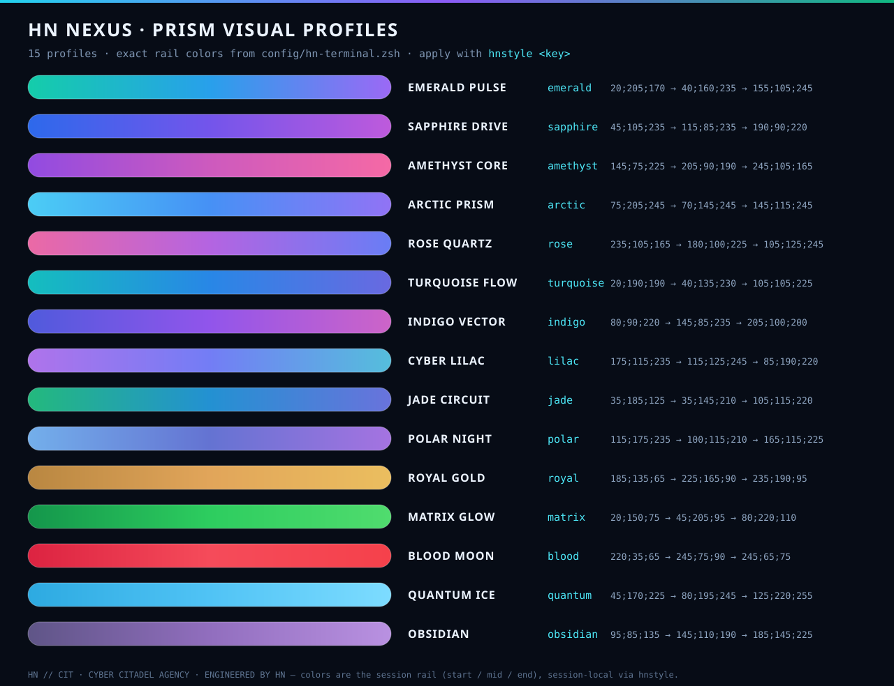
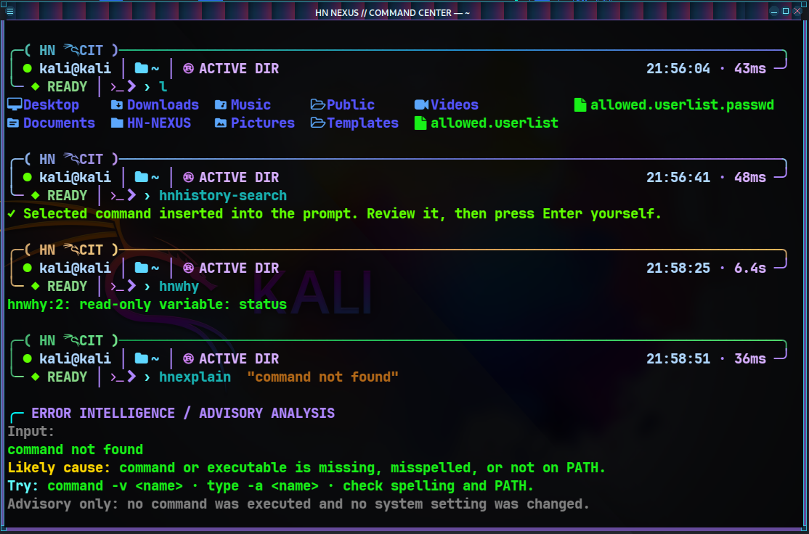
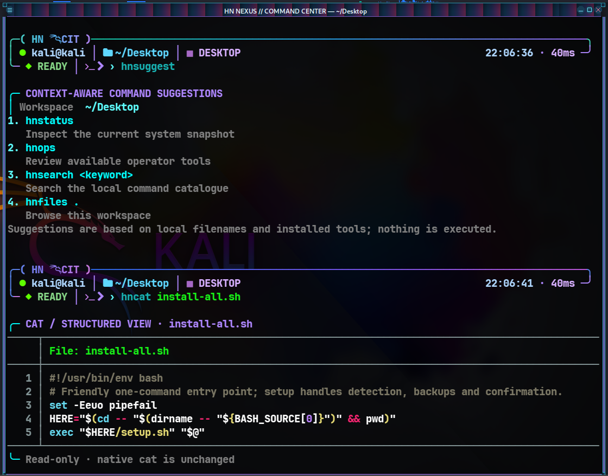
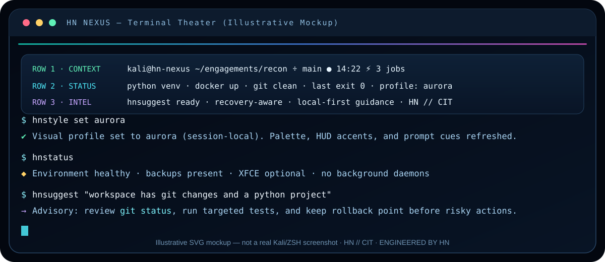
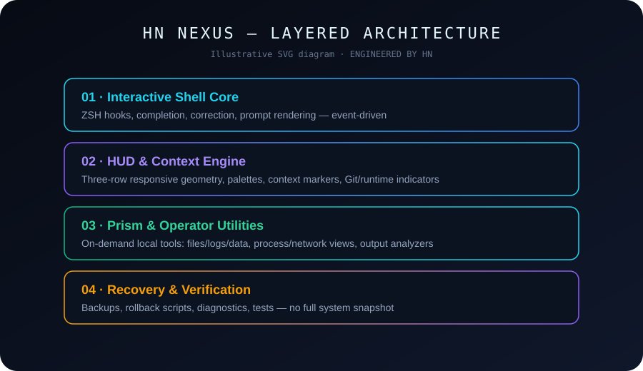

<div align="center">
  

  <br/>

  <p>
    <a href="https://github.com/hhh2006/HN-NEXUS/actions/workflows/ci.yml"></a>
    <a href="https://github.com/hhh2006/HN-NEXUS/actions/workflows/pages.yml"></a>
    <a href="https://hhh2006.github.io/HN-NEXUS/"></a>
    <a href="https://github.com/hhh2006/HN-NEXUS/releases/tag/v1.0.0"></a>
    
    
    
    <a href="LICENSE"></a>
  </p>

  <p>
    <a href="https://github.com/hhh2006/HN-NEXUS"></a>
    <a href="https://github.com/hhh2006/HN-NEXUS/forks"></a>
    <a href="https://github.com/hhh2006/HN-NEXUS/issues"></a>
    <a href="https://github.com/hhh2006/HN-NEXUS/commits/main"></a>
  </p>

  <h3>
    
    &nbsp; HN // CIT &nbsp;·&nbsp; CYBER CITADEL AGENCY &nbsp;·&nbsp; ENGINEERED BY HN &nbsp;
    
  </h3>

  <p><strong>HN NEXUS</strong> — a cinematic, context-aware, recovery-aware ZSH command environment for Kali Linux.</p>
  <p><i>Engineered for control. Designed for precision. Local-first by intent.</i></p>

  <p>
    <a href="https://github.com/hhh2006/HN-BlackBox-CyberSecurity"><b>HN BlackBox</b></a> ·
    <a href="https://hhh2006.github.io/HN-NEXUS/"><b>Website</b></a> ·
    <a href="https://github.com/hhh2006/HN-NEXUS/releases/tag/v1.0.0"><b>Release v1.0.0</b></a> ·
    <a href="docs/COMMAND-REFERENCE.md"><b>Command Reference</b></a> ·
    <a href="docs/TUTORIAL.md"><b>Tutorial</b></a> ·
    <a href="docs/INSTALLATION-AND-RECOVERY.md"><b>Install &amp; Recovery</b></a> ·
    <a href="docs/ARCHITECTURE.md"><b>Architecture</b></a> ·
    <a href="docs/FAQ.md"><b>FAQ</b></a>
  </p>
</div>

<p align="center"></p>

> [!IMPORTANT]
> **Publishing pack:** `v1.0.0` · **Terminal source baseline:** `4.4.2` (kept in [`VERSION`](VERSION) for runtime accuracy).  
> **If GitHub Pages does not open in your network/region** (some ISPs/networks may block `github.io`): browse this repository and [docs](docs/) directly, download [Release v1.0.0](https://github.com/hhh2006/HN-NEXUS/releases/tag/v1.0.0), or open [`website/index.html`](website/index.html) locally after cloning/downloading. A successful Pages deployment means the site is published; external access can still vary by network.

## Table of Contents

- [Overview](#overview)
- [What’s Included](#whats-included)
- [Key Features](#key-features)
- [Prism Visual Profiles](#prism-visual-profiles)
- [Screenshots & Visuals](#screenshots--visuals)
- [Requirements](#requirements)
- [Installation](#installation)
- [Quick Start & Usage Examples](#quick-start--usage-examples)
- [Complete Command Reference](#complete-command-reference)
- [Architecture at a glance](#architecture-at-a-glance)
- [Repository Structure](#repository-structure)
- [Documentation](#documentation)
- [Validation & Quality](#validation--quality)
- [Security, Privacy & Limitations](#security-privacy--limitations)
- [Roadmap & Contributing](#roadmap--contributing)
- [Creator & Contact](#creator--contact)
- [Release & License](#release--license)

<p align="center"></p>

## Overview

**HN NEXUS** is an interactive ZSH command-center experience for **Kali Linux** and compatible Linux environments. It enhances the terminal with a responsive **three-row HUD prompt**, **15 Prism visual profiles** (`hnstyle`), on-demand operator utilities, local advisory helpers, and **backup/recovery-aware** installation flows — while keeping behavior explicit, inspectable, and under user control.

**Who it’s for:** cybersecurity learners and practitioners, developers, and power users who want a clearer, more informative, and visually refined terminal workflow without hidden background agents or automatic command execution.

**Design principles:** local-first · user-invoked · native-command friendly · transparent limitations · recovery-aware.

## What’s Included

- **Terminal/HUD core:** adaptive 3-row prompt, context/runtime/status rendering, Prism palettes, Nerd Font detection with readable fallbacks (`config/hn-terminal.zsh`, `config/hn-sovereign.zsh`).
- **Operator utilities & wrappers:** `hn*` commands for help/discovery, diagnostics, file/log/data viewing, analysis/triage, system/network snapshots, and safe interactive presentation wrappers (`config/hn-tools.zsh`).
- **Installation & recovery:** guided installer, checks/dry-run modes, backups, rollback/recovery helpers, optional XFCE/X11 visual theme application (`setup.sh`, `install.sh`, `uninstall.sh`, `apply-prism-theme.sh`, etc.).
- **Documentation:** architecture, commands, tutorial, installation/recovery, troubleshooting, FAQ, configuration, network/output/operator guides, changelog, and test/verification reports (`docs/`).
- **Website & assets:** cinematic project site and published docs (`website/`), branding/mockups and real screenshots (`assets/`).
- **Quality checks:** local/CI-friendly test scripts and website integrity checks (`tests/`, `.github/workflows/`).

## Key Features

| Area | Highlights |
|---|---|
| **Cinematic HUD** | 3-row responsive prompt (identity, context/path/git/runtime, status/input) updated via ZSH hooks (event-driven), width-aware rendering, safe fallbacks |
| **Visual Profiles** | 15 Prism profiles with `hnstyle` (session-local), Nerd Font/icon-aware presentation with text fallbacks |
| **Discovery & Help** | `hnhelp`, `hnmenu` launcher, `hnsearch`, `hnhistory` (read-only), `hnhistory-search` (inserts selection for review, never auto-runs) |
| **Diagnostics & Status** | `hnstatus`, `hnprism`, `hndoctor`, `hnvisual`, `hncolors`, `hnicons`, `hnhealth`, `hnops` |
| **Files, Logs & Data** | `hnfiles`, `hnicon`, `hncat`, `hnlog`, `hnjson` (jq), `hnyaml` (yq), `hnfind`, `hninspect`, `hndiff`, `extract`, `mkcd` |
| **System & Network Views** | `hnproc`, `hnports` (local listeners), `hnservices`, `hncontainers`, `hnreport`, `hnipa`, interactive presentation for `ps/df/free/ss/du/ip/ls/tree/cat` where applicable |
| **Advisory Intelligence** | `hnsuggest` (context-aware ideas), `hnexplain` (error text hints), `hnwhy` (last exit status) — heuristic, read-only, never auto-executed |
| **Output Triage/Analysis** | `hnoutput`, `hnnet`, `hnanalyze` for supplied/saved output (no scanning/capture performed) |
| **Safety & Recovery** | Timestamped backups, guided install modes, rollback/uninstall helpers, explicit checks/dry-run, no sudo required by project installer |
| **Privacy & Control** | Local-first behavior, no telemetry pipeline for core operation, no automatic package installation, manual control preserved |

> **Note:** Optional features depend on optional tools being installed (e.g. `fzf`, `jq`, `yq`, `bat/batcat`, `eza`, `rg`, `tree`, `docker/podman`). HN NEXUS does not install packages automatically.

## Prism Visual Profiles

Fifteen cinematic rail profiles, selectable per session with `hnstyle <profile>` — automatic cycling by default, pinned when you choose one. The sheet below shows every profile with its **exact runtime rail colors** (start → mid → end), generated from `config/hn-terminal.zsh`:

```zsh
hnstyle list        # show available profiles
hnstyle emerald     # pin a profile for this session
hnstyle auto        # return to automatic cycling
```

<div align="center">
  
  <br/>
  <sub><i>Profiles: <code>emerald</code> · <code>sapphire</code> · <code>amethyst</code> · <code>arctic</code> · <code>rose</code> · <code>turquoise</code> · <code>indigo</code> · <code>lilac</code> · <code>jade</code> · <code>polar</code> · <code>royal</code> · <code>matrix</code> · <code>blood</code> · <code>quantum</code> · <code>obsidian</code> (plus <code>auto</code> cycling). Session-local — nothing persists unless pinned.</i></sub>
</div>

<p align="center"></p>

## Screenshots & Visuals

### Real captures (author-provided)

<table>
  <tr>
    <td width="50%"></td>
    <td width="50%"></td>
  </tr>
</table>

<p align="center"><sub>Real screenshots provided by the project author. Appearance may vary by terminal, font, theme, and environment. Review/redact sensitive information before sharing additional captures.</sub></p>

### Illustrative mockups (labeled, not real runtime screenshots)

<div align="center">
  
  <br/>
  <sub><i>Illustrative cinematic mockup (SVG). Real captures belong in <a href="assets/screenshots/">assets/screenshots/</a>.</i></sub>
</div>

## Requirements

| Item | Required / Optional | Notes |
|---|---|---|
| **OS** | Required | Kali Linux (primary target) or a compatible Linux distribution |
| **Shell** | Required | **ZSH** (interactive use) |
| **Python** | Required | **Python 3** (used by setup/check tooling) |
| **Git / basic CLI** | Recommended | To clone the repository and use common workflows |
| **Terminal emulator** | Required | ANSI-capable terminal; truecolor support recommended for best visuals |
| **Nerd Font** | Recommended (optional) | Improves icons/glyphs; readable text fallbacks are used when unavailable |
| **XFCE + X11** | Optional | Only for optional desktop visual theme (`--visual` / guided prompt on supported sessions); requires `xfconf-query`, `xfce4-terminal` |
| **Optional tools** | Optional | `fzf`, `bat`/`batcat`, `jq`, `yq`, `eza`, `rg`, `tree`, `zoxide`, `btop`, `docker`, `podman`, `systemctl` etc. enable/enhance specific features when present |

> **Important:** run the project installer as a **normal user** (no `sudo`). Keep independent backups of important dotfiles/home data. Full runtime behavior and desktop visuals depend on the target environment.

## Installation

> Read [docs/INSTALLATION-AND-RECOVERY.md](docs/INSTALLATION-AND-RECOVERY.md) before applying changes. Review scripts (`setup.sh`, `install.sh`, `uninstall.sh`) and keep backups.

### 1) Get the project

```bash
git clone https://github.com/hhh2006/HN-NEXUS.git
cd HN-NEXUS
# or download and extract: https://github.com/hhh2006/HN-NEXUS/releases/tag/v1.0.0
```

### 2) Check and preview (no changes)

```bash
chmod +x setup.sh install.sh uninstall.sh
./setup.sh --check     # verify prerequisites without changing files
./setup.sh --dry-run   # preview guided installation actions
```

### 3) Install

```bash
./setup.sh             # guided install (core + optional XFCE visual prompt when supported)
```

**Advanced modes:**

```bash
./setup.sh --core      # terminal core only
./setup.sh --visual    # apply optional XFCE/X11 visual layer (supported sessions)
./setup.sh --full      # guided full installation
```

- Core install creates timestamped backups and recovery/rollback artifacts.
- On supported **XFCE/X11**, you may be prompted once to apply optional desktop styling; on unsupported/non-interactive sessions it is skipped safely.
- No sudo required. The installer does not automatically install system packages or fonts.

### 4) Verify (open a new ZSH session)

```zsh
hnhelp
hnstatus
hnvisual
hndoctor
```

If commands are missing, confirm you launched ZSH and that `~/.zshrc` contains the HN NEXUS managed block. See [Troubleshooting](docs/TROUBLESHOOTING.md).

### 5) Uninstall / Recovery

```bash
./uninstall.sh
```

Follow prompts carefully. Recovery uses available backups/rollback data where safe, but it is **not** a full system snapshot. Keep backup/recovery artifacts until you verify your environment.

## Quick Start & Usage Examples

```zsh
# Discover what’s available
hnhelp
hnmenu
hnsearch network

# Session, status, and diagnostics
hnstatus
hnprism
hndoctor
hnvisual

# Change visual profile (session-local)
hnstyle list
hnstyle royal
hnstyle emerald

# Files and inspection
hnfiles
hnicon ./setup.sh
hninspect ./setup.sh
hncat README.md
hnlog /path/to/app.log

# Search and diffs
hnfind "TODO" .
hndiff old.conf new.conf

# System/process/container/network views (read-only)
hnops
hnproc
hnports
hnhealth
hnservices      # if systemctl available
hncontainers    # if docker/podman available
hnreport

# Advisory helpers (heuristic, never auto-executed)
hnsuggest
hnsuggest "git project"
false; hnwhy
hnexplain "Permission denied"
some_command 2>&1 | hnexplain

# History (read-only; search inserts selection for review only)
hnhistory 30
hnhistory-search "ssh"

# Output/analysis helpers for supplied text or files (no scanning/capture)
hnoutput saved-output.txt
hnnet saved-network-output.txt
hnanalyze saved-nmap-output.txt

# Native commands keep their names; wrappers enhance interactive presentation when applicable
# Use `command <name> ...` to bypass explicitly
command cat README.md
command ip a
```

> **Pipelines/redirections:** presentation wrappers are designed to preserve native behavior for supported scripting cases. Use `command <name>` when you need guaranteed native output.

<p align="center"></p>

## Complete Command Reference

All listed commands are provided by HN NEXUS configuration/runtime as implemented in this repository (primarily `config/hn-tools.zsh` and `config/hn-terminal.zsh`). Behavior may depend on installed optional tools and environment; wrappers preserve native behavior for pipes/redirections and unsupported forms where applicable. Use `command <name>` to bypass wrappers.

### HN commands & helpers

| Command | What it does | Usage / notes |
|---|---|---|
| `hnhelp` | Show the operator quick reference of available HN commands/features | `hnhelp` |
| `hnmenu` | Interactive command-center launcher for common actions | `hnmenu` (select an option) |
| `hnsearch [TEXT]` | Search the HN/native-command and PRISM tool catalogue | `hnsearch docker` |
| `hnstatus` | Compact system/session snapshot | `hnstatus` |
| `hnprism` | Live session / Git / runtime overview | `hnprism` |
| `hnops` | Operations center and tool availability overview | `hnops` |
| `hnvisual` | Check Nerd Font, glyphs, and terminal capabilities | `hnvisual` |
| `hncolors` | Preview PRISM color spectrum | `hncolors` |
| `hnicons` | Preview supported symbol/icon set | `hnicons` |
| `hndoctor` | Diagnose core files, completion, correction, plugins, and optional tools/capabilities | `hndoctor` (read-only) |
| `hnstyle [PROFILE]` | Switch visual palette/profile (automatic or pinned; session-local) | `hnstyle list` · `hnstyle <profile>` (profiles include e.g. `auto`, `emerald`, `sapphire`, `amethyst`, `arctic`, `rose`, `turquoise`, `indigo`, `lilac`, `jade`, `polar`, `royal`, `matrix`, `blood`, `quantum`, `obsidian` as available) |
| `hnfiles [DIR]` | Semantic, icon-aware directory browser (read-only) | `hnfiles` · `hnfiles /var/log` |
| `hnicon PATH` | Identify a file or directory by type | `hnicon ./setup.sh` |
| `hncat FILE` | Numbered, framed text viewer with syntax-aware presentation | `hncat file.txt` |
| `hnlog FILE` | Read logs with severity-aware colors, line numbers, and summary | `hnlog /var/log/syslog` |
| `hnjson FILE` | Pretty-print JSON with syntax colors | `hnjson data.json` (requires `jq`) |
| `hnyaml FILE` | Format YAML | `hnyaml config.yml` (requires `yq` if available) |
| `hnfind TEXT [PATH]` | Search text with colored matches | `hnfind "pattern" .` (prefers `rg`, falls back when available) |
| `hninspect FILE` | File metadata and SHA-256 report | `hninspect <file>` |
| `hndiff OLD NEW` | Semantic diff view | `hndiff a.conf b.conf` |
| `hnproc` | Top processes by CPU usage (snapshot) | `hnproc` |
| `hnports` | Read-only local listening socket overview | `hnports` (not a scanner) |
| `hnhealth` | System health snapshot | `hnhealth` |
| `hnservices` | Read-only systemd service inventory/status | `hnservices` (if `systemctl` available) |
| `hncontainers` | Read-only Docker/Podman container inventory | `hncontainers` (if installed) |
| `hnreport [FILE]` | Create a local, read-only system/network snapshot report | `hnreport` or `hnreport ~/hn-report.txt` (review before sharing) |
| `hnipa` | Explicit IP address matrix/view helper | `hnipa` (native `ip` remains available) |
| `hnhistory [COUNT]` | Read-only, numbered view of recent ZSH history | `hnhistory 30` |
| `hnhistory-search [TEXT]` | Search history (uses `fzf` when installed) and insert selection into prompt for review | `hnhistory-search ssh` (never executed automatically) |
| `hnsuggest [TEXT]` | Context-aware, advisory command suggestions based on local workspace/tools | `hnsuggest` · `hnsuggest git` |
| `hnexplain [ERROR]` | Heuristic explanation/hints for common error text (args or piped input) | `hnexplain "Permission denied"` · `cmd 2>&1 \| hnexplain` |
| `hnwhy` | Explain the last command exit status | `false; hnwhy` |
| `hnoutput [FILE\|-]` | Smart triage of supplied/saved command output | `hnoutput output.txt` (read-only/advisory) |
| `hnnet [FILE\|-]` | Highlight network-related details in supplied output (IPs, ports, protocols, firewall events) | `hnnet net.txt` (no capture/scanning) |
| `hnanalyze [FILE\|-]` | Heuristic analysis of supplied text (e.g. nmap/SSH/DNS/HTTP/firewall-style output) | `hnanalyze nmap.txt` (no scanning performed) |
| `mkcd DIR` | Create a directory and enter it | `mkcd mydir` |
| `extract FILE` | Extract supported archive formats | `extract archive.tar.gz` |

### Interactive presentation wrappers & shortcuts

| Name | What it does | Notes |
|---|---|---|
| `cat`, `hncat` | Interactive, numbered/syntax-aware viewing in supported terminals; `hncat` is the explicit viewer | Pipes/redirections and unsupported forms fall back to native behavior; use `command cat` to bypass |
| `ip` (and `hnipa`) | Semantic/read-only presentation for specific views (e.g. `ip a`, `ip route`, `ip neigh`) in interactive use | Other/mutating `ip` arguments remain native; use `command ip` to bypass |
| `ps`, `df`, `free`, `ss`, `du` | Numbered/semantic color emphasis in interactive terminals | Native behavior preserved for scripting cases where applicable; use `command <name>` to bypass |
| `ls`, `tree` | Interactive color presentation for directory listing/tree where supported | Native tools remain available (`command ls`, `command tree`) |
| `l`, `ll`, `la`, `lt` | Convenience listing shortcuts | Available when `eza` is installed |

> For exhaustive, implementation-aligned details, see [docs/COMMAND-REFERENCE.md](docs/COMMAND-REFERENCE.md).

<p align="center"></p>

## Architecture at a glance

The runtime is layered so that the shell core, the HUD, the operator utilities, and the recovery flow stay separable and inspectable. Full detail lives in [`docs/ARCHITECTURE.md`](docs/ARCHITECTURE.md).

<div align="center">
  
  <br/>
  <sub><i>Illustrative layer diagram (SVG), not a runtime screenshot.</i></sub>
</div>

| Layer | Responsibility |
|---|---|
| **01 · Interactive Shell Core** | ZSH hooks, completion, correction, prompt rendering — event-driven |
| **02 · HUD &amp; Context Engine** | Three-row responsive geometry, palettes, context markers, Git/runtime indicators |
| **03 · Prism &amp; Operator Utilities** | On-demand local tools: files/logs/data, process/network views, output analyzers |
| **04 · Recovery &amp; Verification** | Backups, rollback scripts, diagnostics, tests — no full system snapshot |

## Repository Structure

```text
.
├─ .github/                 # CI, Pages deploy, issue/PR templates
├─ assets/
│  ├─ branding/             # Project branding, hero, agency seal, prism sheet, mockups, SVG assets
│  └─ screenshots/          # Real captures (author-provided / future)
├─ config/                  # ZSH runtime: sovereign entry, HUD/terminal engine, tools/utilities
├─ docs/                    # Full documentation, guides, reports, changelog, verification
├─ recovery/                # Recovery/verification helpers
├─ tests/                   # Static/runtime/theme/installer/website checks
├─ theme/                   # Optional XFCE/GTK/xfwm theme assets
├─ website/                 # GitHub Pages site, published docs mirror, site assets
├─ setup.sh                 # Guided installer entry point
├─ install.sh               # Core install logic
├─ uninstall.sh             # Recovery/uninstall entry point
├─ diagnostics.sh           # Diagnostics helper
├─ apply-prism-theme.sh     # Optional XFCE visual theme apply
├─ enable-prism-blur.sh     # Optional blur helper (environment-dependent)
├─ VERSION                  # Terminal source baseline (4.4.2)
├─ README.md                # Project overview (this file)
└─ LICENSE                  # GNU AGPL v3.0
```

## Documentation

| Start here | Deep dive |
|---|---|
| [Installation & Recovery](docs/INSTALLATION-AND-RECOVERY.md) | [Architecture](docs/ARCHITECTURE.md) |
| [Tutorial (Beginner → Advanced)](docs/TUTORIAL.md) | [Configuration](docs/CONFIGURATION.md) |
| [Command Reference](docs/COMMAND-REFERENCE.md) | [Troubleshooting](docs/TROUBLESHOOTING.md) |
| [FAQ](docs/FAQ.md) | [Test Report v1.0.0](docs/TEST-REPORT-v1.0.0.md) |
| [Network Intelligence](docs/NETWORK-INTELLIGENCE.md) · [Output Intelligence](docs/OUTPUT-INTELLIGENCE.md) · [Operator Utilities](docs/OPERATOR-UTILITIES.md) | [Changelog](docs/CHANGELOG.md) |
| [Visual Assets](docs/VISUAL-ASSETS.md) | Website docs mirror: [`website/docs/`](website/docs/) |

## Validation & Quality

- **Local website/docs integrity check:** `python tests/website-check.py`
- **Project test suite (environment-dependent):** `bash tests/run-all.sh` (some checks require ZSH, ShellCheck, XFCE/X11, or a Kali runtime environment)
- **CI/Pages:** GitHub Actions workflows for checks and Pages deployment — see [Actions](https://github.com/hhh2006/HN-NEXUS/actions)
- **Reports:** [docs/TEST-REPORT-v1.0.0.md](docs/TEST-REPORT-v1.0.0.md) and verification reports in `docs/`

> Test results can be environment-dependent. A skipped test is not a pass. Full ZSH runtime, installer/rollback, XFCE visuals, and live behavior should be validated on the target environment.

## Security, Privacy & Limitations

- **Local-first & user-controlled:** core experience is explicitly invoked; no telemetry pipeline required for core operation; no autonomous command execution.
- **Advisory helpers are heuristic:** suggestions/analysis features are local, read-only aids based on context or supplied text — not AI and not guaranteed correct.
- **No scanning/capture claims:** network/output analysis helpers work on supplied/saved output or local views as documented; they do not perform unauthorized scanning or packet capture.
- **Backups are not full snapshots:** installer recovery aids reduce risk but do not replace independent backups.
- **Environment-dependent behavior:** visuals, fonts, optional tools, desktop theming, and some wrappers depend on terminal/system capabilities.
- **Responsible use:** review scripts before running, protect sensitive data in screenshots/logs/reports, and follow applicable laws and policies.

See [SECURITY.md](SECURITY.md), [SUPPORT.md](SUPPORT.md), and [docs/TROUBLESHOOTING.md](docs/TROUBLESHOOTING.md).

## Roadmap & Contributing

Contributions, issue reports, and improvement ideas are welcome.

- Read [CONTRIBUTING.md](CONTRIBUTING.md) and [CODE_OF_CONDUCT.md](CODE_OF_CONDUCT.md)
- Open issues/discussions with clear reproduction details and environment info
- Potential future directions (examples): broader terminal/tmux compatibility testing, performance tuning, richer configuration/customization, expanded safe diagnostics, improved capture/gallery docs, and deeper validation across Kali environments — while preserving local-first, recovery-aware, user-controlled principles

## Creator & Contact

<div align="center">
  
</div>

| | |
|---|---|
| **Project** | **HN NEXUS** — Cinematic, context-aware ZSH command environment |
| **Identity** | **HN // CIT · CYBER CITADEL AGENCY** |
| **Signature** | **ENGINEERED BY HN** |
| **Creator** | **Hani Khaled Nasser Al-Nasiri** |
| **Role** | Cybersecurity Student — **Al-Razi University** |
| **GitHub** | [@hhh2006](https://github.com/hhh2006) · [hhh2006/HN-NEXUS](https://github.com/hhh2006/HN-NEXUS) |
| **Instagram** | [@haninazarene](https://www.instagram.com/haninazarene/) |
| **Threads** | [@haninazarene](https://www.threads.net/@haninazarene) |
| **Facebook** | [Hani Khaled](https://www.facebook.com/profile.php?id=100093188341353) |
| **Contact** | [alnasryhany185@gmail.com](mailto:alnasryhany185@gmail.com) |

## Release & License

- **Pack release:** [v1.0.0](https://github.com/hhh2006/HN-NEXUS/releases/tag/v1.0.0)
- **Terminal baseline:** `4.4.2` (see [`VERSION`](VERSION))
- **Website:** [https://hhh2006.github.io/HN-NEXUS/](https://hhh2006.github.io/HN-NEXUS/) (if inaccessible in your region, use repo/docs/release or open `website/index.html` locally)
- **License:** [GNU AGPL v3.0](LICENSE)

---

<div align="center">
  
  <br/><br/>
  <b>HN // CIT · CYBER CITADEL AGENCY</b><br/>
  <sub><b>ENGINEERED BY HN</b> — Hani Khaled Nasser Al-Nasiri</sub><br/>
  <sub>Cybersecurity Student — Al-Razi University · <a href="https://github.com/hhh2006">@hhh2006</a> · <a href="mailto:alnasryhany185@gmail.com">alnasryhany185@gmail.com</a></sub>
  <p>
    <a href="https://github.com/hhh2006"></a>
    <a href="https://www.instagram.com/haninazarene/"></a>
    <a href="https://www.threads.net/@haninazarene"></a>
    <a href="https://www.facebook.com/profile.php?id=100093188341353"></a>
  </p>
  <p><sub>Sibling project: <a href="https://github.com/hhh2006/HN-BlackBox-CyberSecurity"><b>HN BlackBox CyberSecurity</b></a></sub></p>
  <br/><br/>
  <i>Control. Precision. Recovery. Clarity.</i>
</div>
